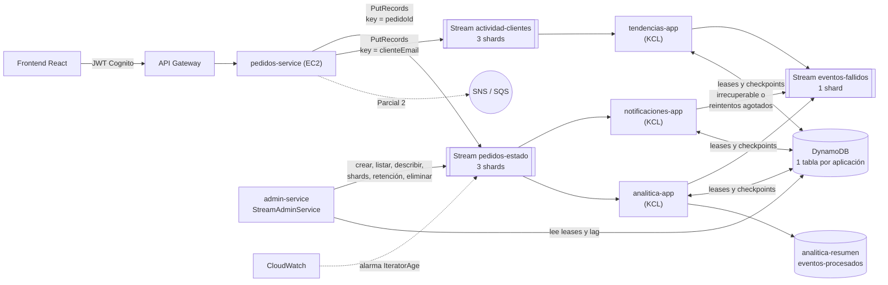
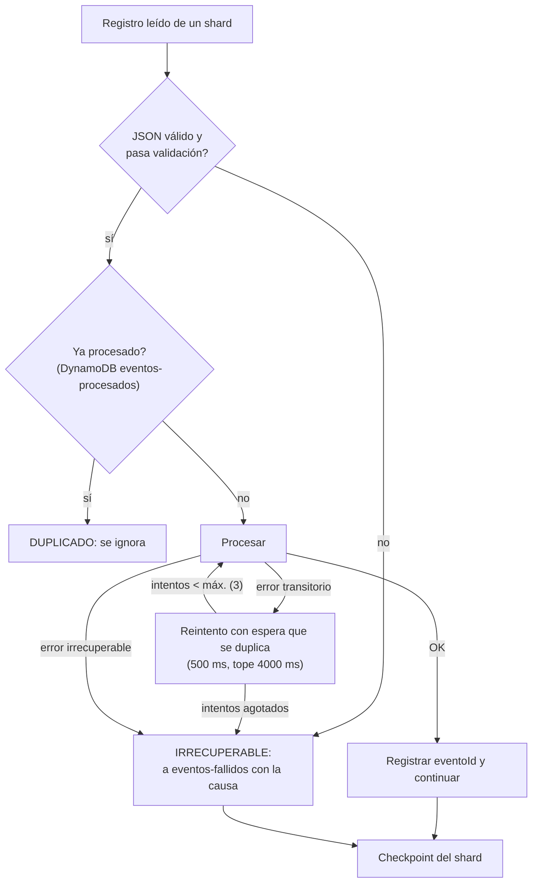
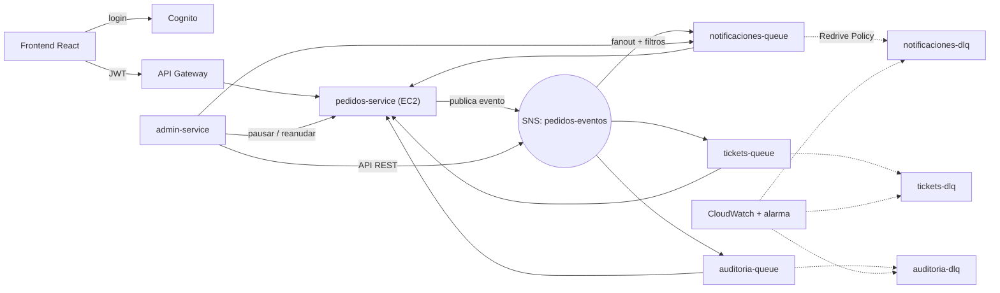
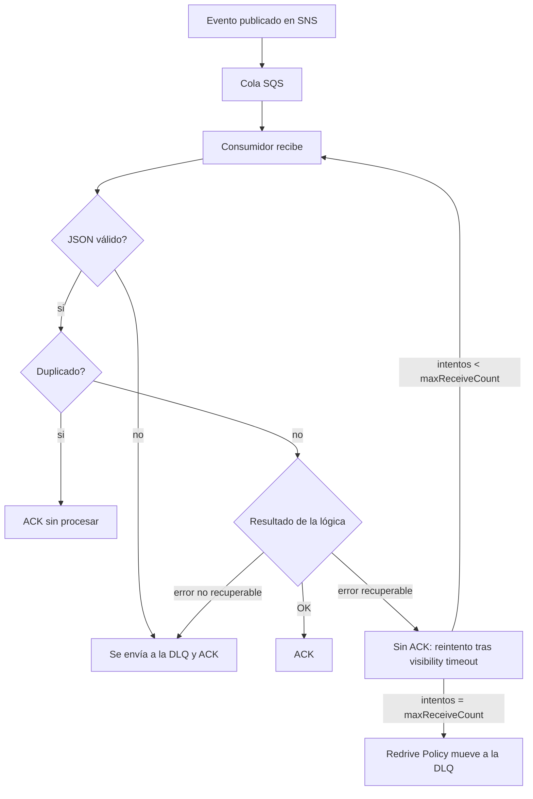

# Pedidos360 - Streaming en tiempo real con Amazon Kinesis Data Streams

Evaluación Parcial N° 3 · DSY1107 Desarrollo Cloud Native I · Duoc UC

**Integrantes:** Tomás Cáceres · Ignacio Calderón

Escala el sistema Pedidos360 (Parcial 1: Cognito, RDS, EC2, API Gateway; Parcial 2: SNS y SQS, que sigue funcionando igual) con una capa de **streaming**: cada cambio de estado de un pedido y cada acción de un cliente se publican como eventos en streams de Kinesis; tres aplicaciones consumidoras (con la Kinesis Client Library) los procesan en paralelo, con reintentos, checkpoints, un stream de eventos fallidos y una alarma de atraso. Un microservicio administrador opera los streams por API REST.

## Componentes

| Componente | Ubicación | Qué hace |
|---|---|---|
| `pedidos-service` (productor) | raíz de este repo (`src/`, paquete `streaming`) | Publica eventos en Kinesis al crear o cambiar un pedido y al recibir actividad de cliente (`POST /api/actividad`) |
| `streaming-service` (consumidores) | `streaming-service/` | Tres aplicaciones consumidoras con KCL 3.x; API de analítica (puerto 8070) |
| `admin-service` (administrador) | `admin-service/` | Mensajería (Parcial 2) y **streams** (Parcial 3, `StreamAdminService`) |
| Scripts de infraestructura | `infra/` | Crean y eliminan streams, alarma y tablas de forma repetible |
| Frontend | `frontend/` | React + TypeScript + Vite + Amplify |

Stack: Spring Boot 4.1.1, Java 17, AWS SDK v2, KCL 3.5.x, DynamoDB (coordinación de KCL), CloudWatch.

## Arquitectura



Cada aplicación consumidora es un **grupo de consumidores independiente**: `notificaciones-app` y `analitica-app` leen el mismo stream `pedidos-estado` sin pisarse, porque cada una lleva su propia tabla de coordinación y su propio checkpoint.

## Streams: parámetros y justificación

Los parámetros están en código (`infra/crear-streams.sh`, repetible) y se justifican aquí. Modo **PROVISIONED**: el enunciado pide 3 shards por stream de negocio y el tráfico es predecible; en ON_DEMAND AWS decide los shards y se pierde el control del paralelismo.

| Stream | Modo | Shards | Retención (diseño) | Clave de partición | Justificación |
|---|---|---|---|---|---|
| `pedidos-estado` | PROVISIONED | 3 | 72 h | `pedidoId` | 3 shards = hasta 3 instancias por aplicación en paralelo; 72 h permite reprocesar tras una caída de fin de semana; los eventos de un mismo pedido caen en el mismo shard y conservan su orden |
| `actividad-clientes` | PROVISIONED | 3 | 24 h | `clienteEmail` | Alto volumen de escritura; la analítica en línea solo necesita datos recientes; la actividad de un cliente se mantiene ordenada |
| `eventos-fallidos` (dead-letter stream) | PROVISIONED | 1 | 168 h | `eventoId` | Llegan pocos eventos; debe retener más que los streams de origen para investigar |

**Aviso sobre el Learner Lab:** una política de la organización (SCP) bloquea `kinesis:IncreaseStreamRetentionPeriod`, por lo que en el laboratorio todos los streams quedan en **24 h** (valor por defecto). Los valores de la tabla son el diseño; el script detecta el bloqueo, lo informa y continúa. Reducir la retención y cambiar shards (`UpdateShardCount`) sí funcionan. Capacidad por shard: 1 MB/s o 1000 registros/s de escritura y 2 MB/s de lectura.

## Diseño de eventos

DTO tipados en JSON, con Bean Validation, compartidos por contrato entre productor y consumidores:

- `EstadoPedidoEvento`: `eventoId`, `tipo`, `pedidoId`, `producto`, `cantidad` (>= 1), `clienteEmail` (formato email), `estado`, `ocurridoEn`.
- `ActividadClienteEvento`: `eventoId`, `tipo`, `clienteEmail`, `producto`, `ocurridoEn`.
- `EventoFallido`: `eventoId`, `aplicacion`, `streamOrigen`, `shardId`, `sequenceNumber`, `causa`, `intentos`, `payload` (el evento original), `fallidoEn`.

El `eventoId` identifica el evento de punta a punta (logs, idempotencia, stream de fallidos). El productor usa `PutRecords` en lotes y reintenta solo los registros rechazados (`failedRecordCount`) con espera creciente (200, 400, 800 ms).

## Consumidores (KCL)

Cada aplicación implementa `ShardRecordProcessor`: el procesador `ProcesadorEventos` aplica el mismo flujo a todas.



| Situación | Qué hace | Log (siempre con eventoId, intento y causa) |
|---|---|---|
| Éxito | Procesa y continúa | `PROCESADO app= eventoId= shard= sequenceNumber= intento=N` |
| Duplicado | Lo ignora | `DUPLICADO ...` |
| Error transitorio | Reintenta duplicando la espera (500 ms, tope 4000 ms), hasta 3 intentos | `REINTENTO ... intento=N/3 causa=...` |
| Reintentos agotados | Envía a `eventos-fallidos` | `ENVIADO AL STREAM DE FALLIDOS ... causa=reintentos agotados` |
| Irrecuperable o inválido | Envía directo a `eventos-fallidos` | `ENVIADO AL STREAM DE FALLIDOS ... causa=...` |

Un evento defectuoso **no detiene el shard**: se registra, se manda a fallidos y se sigue con el siguiente. Para la demostración, los productos `FALLO_TRANSITORIO`, `FALLO_PERSISTENTE` y `FALLO_IRRECUPERABLE` simulan cada caso (`STREAMING_SIMULAR_FALLOS=true`).

**Multi-instancia y checkpoints:** KCL guarda en DynamoDB una fila por shard (dueño y checkpoint). Con 3 shards y 2 instancias, una procesa 2 shards y la otra 1; si una cae, la otra toma sus shards y sigue desde el último checkpoint. El paralelismo máximo de un grupo es el número de shards. Se usa lectura por sondeo (`PollingConfig`) y no enhanced fan-out, para evitar su costo adicional.

## Configuración centralizada

Todos los nombres, streams, aplicaciones, reintentos y tablas están en `application.yml` (`streaming:` en `pedidos-service` y `streaming-service`, `kinesis-admin:` en `admin-service`), enlazados a `@ConfigurationProperties`. Ninguna clase escribe a mano un nombre de stream o de tabla. Las credenciales **nunca** van en el repositorio: se pasan por variables de entorno.

## Microservicio administrador

Detalle en [`admin-service/README.md`](admin-service/README.md). Todo el acceso a Kinesis está encapsulado en `StreamAdminService`; los controladores solo delegan.

| Verbo | Ruta | Qué hace |
|---|---|---|
| GET / POST | `/api/admin/streams` | Listar / crear streams |
| GET | `/api/admin/streams/{nombre}` | Describir (shards, rangos de hash) |
| PUT | `/api/admin/streams/{nombre}/shards` | Cambiar cantidad de shards |
| PUT | `/api/admin/streams/{nombre}/retention` | Cambiar retención |
| DELETE | `/api/admin/streams/{nombre}` | Eliminar |
| GET | `/api/admin/streams/{nombre}/lag` | Atraso (IteratorAge, CloudWatch) |
| GET | `/api/admin/stream-consumers` | Aplicaciones: shards asignados e instancias |
| GET | `/api/admin/stream-consumers/{app}` | Por shard: dueño, checkpoint, atraso |

## Monitoreo

| Métrica | Decisión que se toma |
|---|---|
| `GetRecords.IteratorAgeMilliseconds` | Cuánto va atrasado el consumidor. Si sube, hay que agregar instancias (hasta el número de shards) o revisar caídas |
| `IncomingRecords` / `IncomingBytes` por shard | Detecta un shard caliente (mala distribución de la clave de partición) |
| `WriteProvisionedThroughputExceeded` | Se supera la capacidad de escritura: hay que agregar shards |
| Tabla de coordinación (leaseOwner, checkpoint) | Qué instancia procesa cada shard y hasta dónde llegó |

**Alarma:** `kinesis-pedidos-estado-lag-alto` sobre `IteratorAgeMilliseconds` (máximo, >= 60 s durante 2 períodos de 60 s), creada con `infra/crear-alarma.sh`, que además activa las métricas por shard (enhanced monitoring).

## Cómo ejecutar

Requisitos: Java 17+, credenciales del Learner Lab. **Kinesis cobra por shard y por hora**: crear los streams solo para probar y eliminarlos al terminar.

1. **Streams (CloudShell):** `bash infra/crear-streams.sh` y `bash infra/crear-alarma.sh`.
2. **Consumidores (PowerShell):**
```powershell
$env:AWS_ACCESS_KEY_ID='...'; $env:AWS_SECRET_ACCESS_KEY='...'; $env:AWS_SESSION_TOKEN='...'
$env:AWS_REGION='us-east-1'; $env:STREAMING_HABILITADO='true'
cd streaming-service; ..\mvnw.cmd -q clean package -DskipTests
java -jar target\streaming-service-0.0.1-SNAPSHOT.jar                       # instancia 1 (puerto 8070)
java -jar target\streaming-service-0.0.1-SNAPSHOT.jar --server.port=8071    # instancia 2
```
La primera vez, KCL crea sus tablas de coordinación y espera a que sus índices queden activos (5 a 15 minutos).
3. **Productor:** `pedidos-service` con `STREAMING_HABILITADO=true`; crear o actualizar un pedido y `POST /api/actividad` publican los eventos.
4. **Administrador:** `.\mvnw.cmd -f admin-service\pom.xml spring-boot:run` con `ADMIN_API_KEY`.
5. **Limpieza (importante):** `Ctrl+C` en los consumidores y `bash infra/eliminar-recursos.sh`.

## Casos de uso

1. **Analítica en línea y notificaciones sobre el mismo flujo:** `analitica-app` actualiza contadores por estado mientras `notificaciones-app` avisa al cliente, leyendo el mismo stream con checkpoints independientes. Con SQS, el mensaje se consume una sola vez y habría que duplicarlo con SNS.
2. **Tendencias de actividad de clientes** (`tendencias-app`): productos más vistos casi en tiempo real sobre un volumen alto de eventos.
3. **Reproceso:** la retención permite volver a leer eventos pasados (por ejemplo, desde `TRIM_HORIZON`) para corregir un error o reconstruir un resumen.

## SNS/SQS vs Kinesis

| | SNS + SQS (Parcial 2) | Kinesis Data Streams (Parcial 3) |
|---|---|---|
| Modelo | Mensaje que se consume y se borra | Registro que permanece durante la retención |
| Varios lectores | Fanout con una cola por lector | Varias aplicaciones leen el mismo stream, cada una con su checkpoint |
| Orden | Sin orden (salvo colas FIFO) | Orden por shard, según la clave de partición |
| Reproceso | Solo desde la DLQ | Se puede volver a leer cualquier registro dentro de la retención |
| Escalado | Automático | Por shards (se administra) |
| Cuándo conviene | Tareas y notificaciones desacopladas | Flujo continuo de eventos, analítica en línea, reproceso |

## Pruebas realizadas

Probado en AWS (Learner Lab) con 3 aplicaciones consumidoras sobre los streams de 3 shards: eventos normales repartidos entre los 3 shards, **duplicado** ignorado, **error transitorio** reintentado, **error persistente** enviado a `eventos-fallidos` tras 3 intentos, **irrecuperable y evento inválido** enviados directo a fallidos, **failover** al apagar una instancia (la otra toma los 3 shards) y **rebalanceo** al levantar una segunda (2 + 1 shards). Las capturas están en `docs/capturas/`.

---

# Anexo: Parcial 2 - Mensajería con SNS y SQS

Sigue funcionando sin cambios: el backend publica cada evento de pedido en SNS (que reparte a tres colas SQS) y, además, en Kinesis.

### Componentes

| Componente | Ubicación | Tecnología |
|---|---|---|
| `pedidos-service` (productor y consumidores) | raíz de este repo (`src/`) | Spring Boot 4.1.1, Java 17, Spring Cloud AWS 4.0.0 |
| `admin-service` (administrador) | `admin-service/` | Spring Boot 4.1.1, Java 17, Spring Cloud AWS 4.0.0 |
| Frontend | `frontend/` (antes repo `pedidos360-frontend`) | React + TypeScript + Vite + Amplify (login con Cognito) |

Se mantiene lo del Parcial 1: base de datos en RDS (MySQL), validación del JWT de Cognito en el backend, login del frontend con Cognito y consumo del backend a través del API Gateway.

### Arquitectura



### Topología de mensajería

Tópico: `pedidos-eventos`. Todos los nombres y parámetros están centralizados en `src/main/resources/application.yml` (clase `MensajeriaProperties`) y la topología se declara en `MensajeriaTopologia`, separada de la lógica de negocio.

| Cola | Función | Eventos que recibe (filtro `tipoEvento`) | DLQ |
|---|---|---|---|
| `notificaciones-queue` | Avisos al cliente | `PEDIDO_CREADO`, `PEDIDO_ENVIADO` | `notificaciones-dlq` |
| `tickets-queue` | Generación de tickets/documentos | `PEDIDO_CREADO` | `tickets-dlq` |
| `auditoria-queue` | Registro de todos los eventos | todos (sin filtro) | `auditoria-dlq` |

**Dos patrones de enrutamiento**
- **Fanout:** un `PEDIDO_CREADO` llega a las tres colas. Se usa cuando varios dominios deben reaccionar al mismo hecho.
- **Entrega selectiva (filtros de suscripción):** un `PEDIDO_ENVIADO` llega solo a notificaciones y auditoría, y un `PEDIDO_ENTREGADO` solo a auditoría. Se usa cuando cada dominio solo necesita parte de los eventos. El productor envía el atributo `tipoEvento` y SNS filtra.

Las suscripciones usan **raw message delivery**: la cola recibe el JSON del evento tal cual, sin el sobre de SNS.

### Consumidores

Uno por dominio, con `@SqsListener` y confirmación manual (`MANUAL`):

- `mensajeria/consumidor/notificaciones/NotificacionesConsumidor`
- `mensajeria/consumidor/tickets/TicketsConsumidor`
- `mensajeria/consumidor/auditoria/AuditoriaConsumidor`

El flujo común está en `ProcesadorMensajes`:

| Situación | Qué hace | Log |
|---|---|---|
| Éxito | Ejecuta la lógica y confirma (ACK) | `OK eventoId=... intento=N (ACK)` |
| Mensaje duplicado | Confirma sin volver a procesar | `DUPLICADO ignorado ...` |
| Error recuperable | **No** confirma: SQS lo reentrega tras el visibility timeout; al llegar a `maxReceiveCount` la Redrive Policy lo mueve a la DLQ | `REINTENTO eventoId sqsId intento=N/M causa` |
| Error no recuperable (JSON inválido, datos inválidos) | Lo envía directo a la DLQ y confirma el original | `NO RECUPERABLE id intento causa -> enviado a <dlq>` |

Todos los registros incluyen id, intento y causa. Para la demostración, `TicketsConsumidor` falla si el producto del pedido es `FALLO_RECUPERABLE` o `FALLO_NO_RECUPERABLE`; con `MENSAJERIA_SIMULAR_FALLOS=false` deja de fallar (sirve para mostrar el reproceso de la DLQ).

> Limitación conocida: la detección de duplicados se guarda en memoria de cada instancia. Con varias instancias, un mismo mensaje reentregado podría procesarse en otra. La mejora natural es registrar los `eventoId` procesados en la base de datos.

### Políticas de retención y limpieza

| Cola | Retención | Visibility timeout | maxReceiveCount | Justificación |
|---|---|---|---|---|
| `notificaciones-queue` | 1 día | 30 s | 3 | Un aviso viejo pierde valor; no conviene notificar algo obsoleto |
| `tickets-queue` | 4 días | 60 s | 3 | El documento debe generarse aunque el servicio esté caído un fin de semana; generar un ticket tarda más |
| `auditoria-queue` | 7 días | 30 s | 5 | El registro no debe perderse; más intentos porque es un fallo transitorio de escritura |
| Todas las DLQ | 14 días (máximo) | - | - | Tiempo para investigar y reprocesar. La retención corre desde que el mensaje entró a la cola original, por eso la DLQ retiene más que su origen |

- El **visibility timeout** es mayor que el tiempo máximo de procesamiento, para que un mensaje en proceso no se entregue dos veces.
- **Limpieza:** la retención elimina automáticamente los mensajes viejos. Además el administrador puede purgar colas y DLQ (`POST /api/admin/queues/{nombre}/purge`, `POST /api/admin/dlq/{nombre}/purge`) y reprocesar la DLQ (`/redrive`). Así ninguna cola crece sin control.

### Monitoreo (CloudWatch)

Métricas por cola: mensajes disponibles (`ApproximateNumberOfMessagesVisible`), en proceso (`ApproximateNumberOfMessagesNotVisible`), antigüedad del mensaje más antiguo (`ApproximateAgeOfOldestMessage`) y mensajes en las DLQ.

| Métrica | Decisión que se toma |
|---|---|
| Mensajes disponibles | Si sube de forma sostenida, hay que levantar más instancias del consumidor |
| Mensajes en proceso | Si es alto, los consumidores están lentos o colgados |
| Antigüedad del mensaje más antiguo | Si se acerca a la retención, se está por perder mensajes |
| Mensajes en DLQ | Cualquier valor mayor a 0 es un fallo que hay que investigar |

**Alarma:** una alarma por DLQ sobre `ApproximateNumberOfMessagesVisible >= 1` (período de 1 minuto), creada en la consola de CloudWatch.

### Microservicio administrador

Detalle de la API en [`admin-service/README.md`](admin-service/README.md). Resumen:

- Colas: crear, eliminar, listar, estado, purgar
- Tópicos: crear, eliminar, listar
- Suscripciones: crear (con filtro), listar, eliminar
- DLQ: estado, reprocesar, purgar
- Consumidores: listar, pausar, reanudar (llama al endpoint interno `/internal/consumidores/**` de cada instancia de `pedidos-service`)

### Cómo ejecutar

Requisitos: Java 17 o superior, credenciales del AWS Academy Learner Lab. **Las credenciales y las claves nunca se suben al repositorio**: se pasan como variables de entorno.

```powershell
$env:AWS_ACCESS_KEY_ID='...'
$env:AWS_SECRET_ACCESS_KEY='...'
$env:AWS_SESSION_TOKEN='...'
$env:AWS_REGION='us-east-1'
$env:MENSAJERIA_TOPOLOGIA_HABILITADA='true'   # crea tópico, colas y suscripciones al arrancar
$env:ADMIN_API_KEY='<clave del administrador>'
```

**pedidos-service** (puerto 8080):
```powershell
.\mvnw.cmd spring-boot:run
# con la base de datos en RDS:
$env:RDS_PASSWORD='...'; .\mvnw.cmd spring-boot:run "-Dspring-boot.run.profiles=rds"
```

**Segunda instancia del consumidor** (para la demostración de disponibilidad), en otra terminal:
```powershell
.\mvnw.cmd spring-boot:run "-Dspring-boot.run.arguments=--server.port=8082"
```

**admin-service** (puerto 8090):
```powershell
.\mvnw.cmd -f admin-service\pom.xml spring-boot:run
```

Sin `MENSAJERIA_TOPOLOGIA_HABILITADA=true` el backend arranca igual (con un publicador vacío), útil para desarrollo local con H2.

### Flujo de un mensaje


